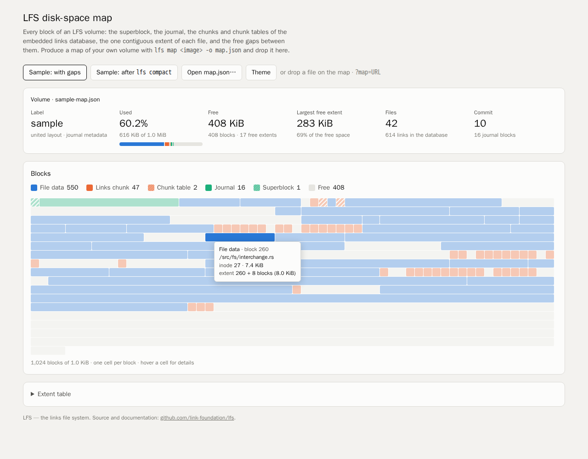

# LFS — the links file system

A file system driver in Rust for Linux, macOS and Windows whose metadata is
an embedded [doublets](https://github.com/linksplatform/doublets-rs) links
database. The file system and the database share one optional journal, every
file is one contiguous extent, and the gaps between files are filled with
link chunks, so the volume does not fragment.

[](https://github.com/link-foundation/lfs/actions?workflow=CI%2FCD+Pipeline)
[](https://crates.io/crates/links-fs)
[](https://docs.rs/links-fs)
[](https://www.rust-lang.org/)
[](http://unlicense.org/)



## Features

- **One store for everything.** Inodes, names, directory entries and
  symbolic links are ordinary links of a doublets store
  (`index: source -> target`). Users create, query, import and export their
  own links in the same store. One commit is one atomic transaction for both.
- **One optional journal.** Its modes are `off`, `metadata` and `full`, so the
  links database is never journaled twice ("journaling of journal").
- **No fragmentation.** Every file is one contiguous extent. Links, inodes and
  index nodes live in small relocatable chunks that fill the gaps between
  files. Online compaction moves everything down so the free space is one
  extent again. `lfs resize` grows a volume into a larger image or
  partition, or shrinks it, in one atomic commit.
- **Configurable layout.** The format can be the united doublets layout
  (64-byte records, byte-compatible with `UnitedMemoryLinks<u64>`), the split
  layout (16-byte data and a 48-byte index), or data only.
- **Variable-size index.** Each link's set of users is kept either as a
  size-balanced tree or as an experimental bit string. In `adaptive` mode the
  set switches at a density threshold (`auto` = 1/192), with hysteresis.
- **Runtime configuration.** Journal mode, allocator, gap filling, index
  mode, threshold, compaction and more change without reformatting. They are
  stored in links notation inside the volume, so an external drive carries
  its settings. They can also be changed live through `/.lfs/config`.
- **Binary links notation.** Names are binary links notation strings. The
  whole store imports and exports as binary links notation archives (as
  link-cli writes them), doublets `.links` files, or LiNo text.
- **Portable images.** Images are little-endian on regular files or raw
  devices, mountable with FUSE (Linux, FreeBSD, macOS with macFUSE),
  Dokan 2 (Windows x64) and NFS version 3 (macOS with no extension, Linux).
- **Disk-space map.** `lfs map` and `/.lfs/map.json` say who owns every
  block. The [visualizer](https://link-foundation.github.io/lfs/visualizer/)
  on GitHub Pages draws it.
- **Crash safety.** The allocation state is rebuilt from block owners at
  mount, so there is no bitmap to disagree with. Freed blocks stay reserved
  until the commit lands. `lfs fsck` checks every invariant.

## Quick Start

```bash
cargo install links-fs            # the `lfs` command line tool

lfs mkfs disk.lfs --size 64M --label demo
lfs put disk.lfs notes.txt /      # copy host files in (directories with -r)
lfs ls disk.lfs /
lfs cat disk.lfs /notes.txt
lfs get disk.lfs /notes.txt copy.txt

lfs links disk.lfs point          # (245: 245 245)
lfs links disk.lfs create 245 '$7'
lfs links disk.lfs --source 245   # query the embedded links database
lfs export-links disk.lfs store.lino

lfs compact disk.lfs              # defragment the free space
lfs resize disk.lfs --size 1G     # grow (or shrink, compacting first)
lfs map disk.lfs > map.json       # open it in the visualizer
lfs fsck disk.lfs
```

### Mounting

```bash
cargo install links-fs --features fuse    # Linux, FreeBSD, macOS
lfs mount disk.lfs /mnt/lfs               # Ctrl-C unmounts and commits
echo '(journal: off)' > /mnt/lfs/.lfs/config

cargo install links-fs --features dokan   # Windows x64
lfs mount disk.lfs M:

cargo install links-fs --features nfs     # any system with an NFS client
lfs mount --nfs disk.lfs ~/lfs            # macOS: built-in mount_nfs, no root
lfs serve disk.lfs --listen 127.0.0.1:2049  # serve only; prints the mount command
```

| Platform | Driver | Needs at run time |
| -------- | ------ | ----------------- |
| Linux, FreeBSD | FUSE (`fuser`, pure Rust) | `fusermount3` (`apt install fuse3`) |
| macOS | FUSE | [macFUSE](https://osxfuse.github.io/) (also needed to build) |
| Windows x64 | Dokan 2 (own binding over `dokan-sys`) | [Dokan 2](https://github.com/dokan-dev/dokany/releases) |
| macOS, Linux | NFS version 3 server (`nfs3_server`) on localhost | `mount_nfs` (built in on macOS), `mount -t nfs` as root (`apt install nfs-common`) |

The NFS driver needs no kernel extension, which is why macOS CI mounts
through it. NFS version 3 has no hard links in the server library, ignores
the mode of `mkdir` (directories start as `0755`) and trusts the uid a client
sends, so `lfs serve` listens on `127.0.0.1` unless told otherwise.

Every mounted volume has a virtual `.lfs` directory with four files:
`config` (write `(key: value)` lines to apply them), `map.json`, `links` and
`stats`. Set `LFS_DOKAN_TRACE=1` on Windows to log every Dokan callback to
standard error.

### As a library

```rust
use links_fs::config::FormatOptions;
use links_fs::device::MemDevice;
use links_fs::fs::{Creator, Fs, ROOT_INO};

fn main() -> links_fs::error::Result<()> {
    let mut fs = Fs::format(MemDevice::new(4 << 20), &FormatOptions::default(), "demo")?;
    fs.set_config_value("index", "adaptive")?;
    let ino = fs.create(ROOT_INO, "hello.txt", 0o644, Creator::default())?.ino;
    fs.write(ino, 0, b"Hello, links!")?;
    let (a, b) = (fs.create_point()?, fs.create_point()?);
    fs.create_link(a, b)?;
    assert_eq!(fs.read(ino, 0, 64)?, b"Hello, links!");
    fs.commit()?;
    Ok(())
}
```

`cargo run --example basic_usage` runs the full example
(`examples/basic_usage.rs`). It covers user links, compaction and the space
map.

### Development

```bash
cargo build --all-features
cargo test --all-features         # unit, integration, FUSE and NFS tests
cargo fmt --check
cargo clippy --all-targets --all-features -- -D warnings
rust-script scripts/check-file-size.rs
bash experiments/fuse_smoke.sh    # mount an image and use it with coreutils
bash experiments/issue-1-cross-check.sh   # clippy for windows-gnu and macOS
```

The FUSE mount tests skip when `/dev/fuse` is missing, unless
`LFS_REQUIRE_FUSE=1` is set. The Windows tests do the same unless
`LFS_REQUIRE_DOKAN=1` is set. The NFS tests talk to the server with an NFS
client library on every system; `LFS_REQUIRE_NFS=1` also mounts a volume
with the system's NFS client (through `sudo -n` where a user cannot mount).
CI sets all three.

## Configuration

Runtime keys (`lfs config IMAGE key=value` persists them, `--set key=value`
applies them for one run, and `/.lfs/config` applies them while mounted):

| Key | Values | Default |
| --- | ------ | ------- |
| `journal` | `off`, `metadata`, `full` | `metadata` |
| `commit-every` | operations between automatic commits (0: only on sync) | `64` |
| `alloc` | `best-fit`, `first-fit` (file extents) | `best-fit` |
| `gap-fill` | put link chunks into the smallest gaps | `on` |
| `growth-percent` | extra room reserved when a file grows | `25` |
| `index` | `off`, `tree`, `bitstring`, `adaptive` (the variable-size index) | `off` |
| `bitstring-threshold` | `auto` or a percent of all links | `auto` |
| `hysteresis-percent` | go back to a tree below this % of the threshold | `50` |
| `auto-compact` | compact when a file cannot otherwise grow | `on` |
| `atime` | update access times | `off` |
| `read-only` | refuse every change | `off` |
| `protect-structure` | keep user links off the file system's own links | `on` |

Format options are chosen once with `lfs mkfs`: `--block-size`, `--layout
united|split|data-only`, `--names chars|packed` and `--journal-blocks`
(`0` means no journal).

The design, the on-disk format, the research behind it and how each
requirement of issue #1 is met are in
[docs/case-studies/issue-1](docs/case-studies/issue-1/README.md).

## Deploying API documentation

The `deploy-docs` job in `.github/workflows/release.yml` publishes `cargo doc --no-deps --all-features` output and the disk-space map visualizer (`/visualizer/`) to GitHub Pages on every push to `main` and on `workflow_dispatch` with `release_mode == 'instant'`. It adds a root `index.html` redirect to the generated crate documentation and a `.nojekyll` marker so rustdoc assets are served verbatim. It uses the official `actions/configure-pages` / `actions/upload-pages-artifact` / `actions/deploy-pages` flow, which requires the repository's Pages source to be set to **GitHub Actions**.

Before the first run on `main`, open **Settings → Pages** of the new repository and set **Source = GitHub Actions**. This is a one-time manual step and cannot be configured from a workflow. The `deploy-docs` job will then provision the Pages site on its first run.

### Optional desktop releases

Set the repository variable `DESKTOP_RELEASE_ENABLED` to `true` to enable
`.github/workflows/desktop-release.yml`. Pull requests then dry-run a six-target
matrix; successful releases publish the non-empty files produced by
`scripts/package-desktop.sh`, SLSA provenance attestations, `SHA256SUMS.txt`, and
`BUILD-PROVENANCE.txt`. The same Pages site exposes the latest assets at
`/download/` using the GitHub Releases API.

The included packaging hook builds the `lfs` executable. Desktop
applications should replace its implementation while retaining the
`<target-label> <output-directory>` interface. For electron-builder 26 macOS
ad-hoc builds, pass `-c.mac.identity=-`, retain `CSC_FOR_PULL_REQUEST=true` for
the PR dry run, and emit an app with
`Contents/_CodeSignature/CodeResources`; the workflow smoke test rejects an
unwrapped `.app` directory.

If this step is skipped, the first `deploy-docs` run fails on `actions/deploy-pages@v5` with `Error: Get Pages site failed.` / `Error: Failed to create deployment`. Flip the Pages source as described above and re-run the failed job; no workflow changes are required.

## Contributing

Contributions are welcome! Please see [CONTRIBUTING.md](CONTRIBUTING.md) for
the development setup, the checks CI runs, and how to add a changelog
fragment (`changelog.d/`).

## License

[Unlicense](LICENSE) - Public Domain

This is free and unencumbered software released into the public domain. See [LICENSE](LICENSE) for details.

## Acknowledgments

- [doublets-rs](https://github.com/linksplatform/doublets-rs) and
  [Data.Doublets](https://github.com/linksplatform/Data.Doublets): the links
  store and its size-balanced trees
- [link-cli](https://github.com/link-foundation/link-cli) and
  [links-notation](https://github.com/link-foundation/links-notation): the
  query model, LiNo and binary links notation
- [fuser](https://github.com/cberner/fuser) and
  [Dokan](https://github.com/dokan-dev/dokany): the user-space file system
  frameworks
- [rust-ai-driven-development-pipeline-template](https://github.com/link-foundation/rust-ai-driven-development-pipeline-template):
  the CI/CD pipeline
