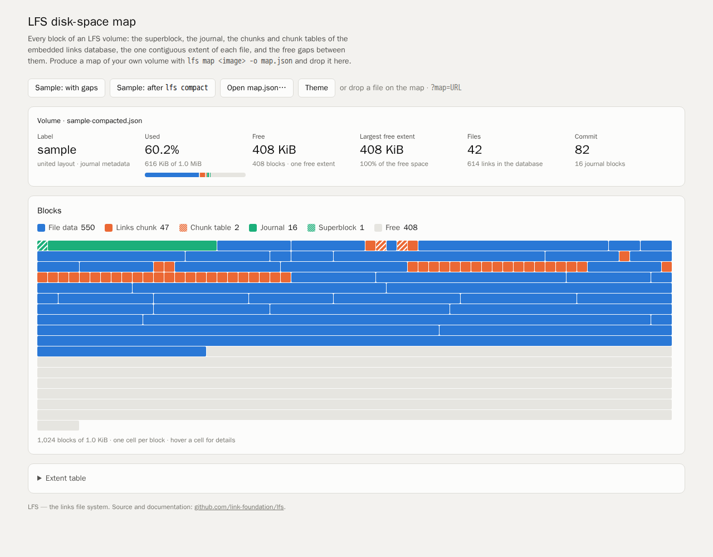
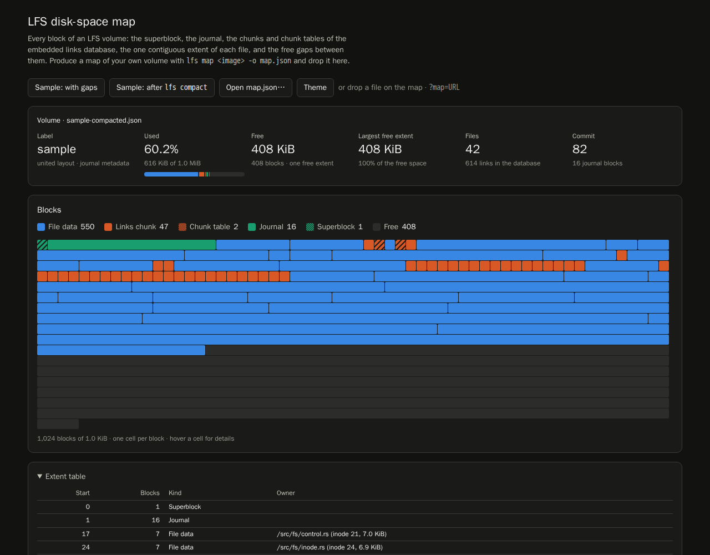

# Case study: issue #1, a links file system for Linux, macOS and Windows

Issue: [link-foundation/lfs#1](https://github.com/link-foundation/lfs/issues/1)
"Links file system driver for Linux, macOS, Windows". Pull request:
[link-foundation/lfs#2](https://github.com/link-foundation/lfs/pull/2).

This document collects what the issue asks for, what was found while
researching it, the design that came out of it, and the evidence (tests,
experiments, screenshots) that each requirement is met. Two research notes
hold the detail behind the decisions:

- [research-filesystems.md](research-filesystems.md): ext4 and other on-disk
  designs, the cost of stacked journals, user-space file system frameworks,
  and the bitstring versus tree break-even.
- [research-linksplatform.md](research-linksplatform.md): the doublets store
  byte for byte, size-balanced trees, link-cli, and binary links notation v1.

## Contents

1. [Timeline](#1-timeline)
2. [Requirements](#2-requirements)
3. [Existing components considered](#3-existing-components-considered)
4. [Design](#4-design)
5. [Requirement → implementation → evidence](#5-requirement--implementation--evidence)
6. [Root causes found along the way](#6-root-causes-found-along-the-way)
7. [Limits and open items](#7-limits-and-open-items)
8. [How to reproduce](#8-how-to-reproduce)

## 1. Timeline

All times are UTC.

| When | Event |
| ---- | ----- |
| 2026-10-21 18:18 | Issue #1 opened. |
| 2026-10-21 | Research: Links Platform storage, link-cli, links-notation, ext4, double journaling, FUSE, Dokan and WinFsp, bitstring indexes. |
| 2026-10-21 | Core: block allocator, relocatable chunked arrays, SBT, configuration, variable-size store, embedded links database, journal, superblock. |
| 2026-10-21 | File system core (directories, contiguous files, commit, fsck, `/.lfs`), links import and export, the `lfs` CLI, doublets compatibility tests. |
| 2026-10-21 | FUSE and Dokan drivers; CI mounts real volumes on Linux and Windows. |
| 2026-10-22 | Compaction fixes, the GitHub Pages visualizer, Windows time precision, a Dokan crash fixed with an own binding, documentation. |

## 2. Requirements

Every requirement of the issue text, in the issue's order:

| # | Requirement (from the issue) |
| - | ---------------------------- |
| R1 | An own file system driver, based on the experience of link-cli and links-notation. |
| R2 | Gaps between files are filled with small doublet links. |
| R3 | Configurable, so its characteristics can be changed without redeploying the driver. |
| R4 | Binary links notation support, if possible exactly as elsewhere. |
| R5 | An optional journal. |
| R6 | Bitstring indices as an experimental alternative to binary tree indices. |
| R7 | Mandatory embedded indexing, like unified and split links. |
| R8 | Optional indexing in the variable-size store with trees and bitstrings, switched at a usage-percentage threshold. |
| R9 | Take the best linksplatform ideas and make them configurable. |
| R10 | A GitHub Pages site showing how the file system maps disk space. |
| R11 | ext4-like capabilities with no fragmentation, as simple as possible. |
| R12 | A universal links database embedded in the file system, sharing one journal. |
| R13 | Works on Linux, macOS and Windows; portable enough for external drives. |
| R14 | Written in Rust. |
| R15 | Public domain (Unlicense). |
| R16 | Data and a deep case study in `docs/case-studies/issue-1`, with online research, every requirement, solutions and existing components. |

## 3. Existing components considered

Details and sources are in the research notes. The choices:

| Need | Considered | Chosen | Why |
| ---- | ---------- | ------ | --- |
| Linux, macOS, FreeBSD mount | `fuser`, `fuse3`, `polyfuse`, NFS (`nfsserve`) | `fuser` 0.18 (MIT) | Pure Rust on Linux; macOS through macFUSE; widely used. |
| Windows mount | WinFsp (`winfsp-rs` is GPL-3.0), Dokan (`dokan` MIT, DLL LGPL), ProjFS | Dokan 2 through `dokan-sys` (MIT) with an own safe layer | License compatible with the Unlicense; the `dokan` crate crashes on null contexts (see [§6](#6-root-causes-found-along-the-way)). |
| Binary links notation | Own codec, `links-notation` crate | `links-notation` 0.27 | The reference implementation; the golden archive test compares byte for byte with link-cli. |
| Links store | `doublets` 0.8 on `FileMapped` | Own block-level store, same record format | `FileMapped` stores do not survive a reopen (linksplatform/mem-rs#36), and a file system needs block-level, journaled writes. `doublets` is a dev-dependency for compatibility tests. |
| Bitstrings | `roaring`, `bitvec`, linksplatform `BitString` | Own bit strings in the variable-size store | They must live in the same journaled, relocatable chunks as everything else. |
| Template for a COW Rust FS | RedoxFS, `fatfs`, `ext4-view` | Own design | None has links as metadata or contiguous-only files. |

## 4. Design

LFS is one OS-independent core (`src/` except `src/driver`) on a block
device, and thin mount drivers. The same core runs on image files, raw
devices, in memory (tests and examples) and behind FUSE or Dokan.

### 4.1 On-disk layout

```text
block 0        superblock: the only root (src/superblock.rs)
journal        optional fixed region, one transaction at a time (src/journal.rs)
chunk tables   one contiguous extent per array: u64 block number per chunk
chunks         one-block pieces of the links, inodes, usage and varstore arrays
file extents   one contiguous extent per file
```

- **No allocation bitmap.** Free space is rebuilt at mount from the owners
  listed in the superblock and the file extents in the inode records, so
  every block has exactly one owner (`src/space.rs`). This removes the
  class of bitmap and metadata mismatches, and it is what the disk map
  draws.
- **Chunked arrays** (`src/chunked.rs`) hold links, inodes, usage handles
  and each size class of the variable-size store. A chunk is one block and
  can sit anywhere, so chunks are what fills the gaps between files (R2).
  They are relocatable: the allocator moves them to let a file grow in place.
- **Delayed allocation:** new chunks get blocks only at commit, so the
  allocator sees all new chunks at once and puts each in the smallest gap
  (`gap-fill`).
- All integers are little-endian with CRC-32 checksums (`src/codec.rs`), so
  images move between machines and operating systems (R13).

### 4.2 Files and directories are links

The file system's metadata is the embedded links database (`src/fs/mod.rs`):

```text
inode     I = (TYPE, $slot)        slot of the 64-byte inode record
name      N = (STRING, chain)      binary links notation string
entry     E = (D, N)               name N in directory D
binding   B = (E, I)               the entry points at inode I
symlink   S = (I, N)               symbolic link I points at text N
config    C = (CONFIG, N)          persisted runtime configuration
```

Links `1..=5` are the binary links notation marker points, so names are
binary links notation strings (`src/fs/names.rs`). Because a doublet is
unique by source and target, a name exists at most once per directory and
each name text is stored once per volume. External values (slots, code
points) use the `Platform.Data.Hybrid` encoding, as binary links notation
and link-cli do.

### 4.3 Link layouts (R7, R9)

Chosen at `lfs mkfs --layout` (`src/links/records.rs`):

- **united:** the 64-byte doublets `UnitedMemoryLinks<u64>` record, header in
  record 0, two global size-balanced trees. The record array is byte for
  byte a doublets `.links` file.
- **split:** 16-byte data records plus 64-byte index records shaped like the
  doublets `IndexPart`, with per-link trees of users.
- **data-only:** 16-byte records without an embedded index, for experiments.

The trees use Chen Qifeng's size-balanced tree, as doublets does, with plain
subtree counts, so they are compatible with the doublets `size_as_*` cells
(`src/sbt.rs`).

### 4.4 The optional variable-size index and bitstrings (R6, R8)

`src/varstore.rs` is a variable-size store with power-of-two size classes
from 16 bytes to 1 MiB. Each class is a chunked array, so variable-size
objects never fragment the device. On top of it, `src/links/usage.rs` keeps
for each link and role the set of links using it, encoded as either:

- a size-balanced tree: 24 bytes per user (three 64-bit cells); or
- a bit string: one bit per link in the store.

A bit string costs `N/8` bytes and a tree `24k` bytes for `k` users among `N`
links, so the break-even density is `k/N = 1/(8·24) = 1/192`
(research-filesystems.md §4.2). `index=adaptive` picks the encoding per set.
Above `bitstring-threshold` (default `auto` = 1/192, or a percentage) a set
becomes a bit string; it goes back to a tree only below `threshold ×
hysteresis-percent`. This stops sets near the boundary from flipping, the
same idea as Roaring's 4096 cut-off and btrfs's free-space-tree conversion.
`index=tree` and `index=bitstring` force one encoding; `index=off` keeps
only the embedded index. All four switch at run time.

### 4.5 Contiguous files and no fragmentation (R2, R11)

Every file is one extent (`src/fs/file.rs`). A file that must grow tries, in
order:

1. growing in place with `growth-percent` extra room, then exactly;
2. moving the link chunks right after it elsewhere, then growing in place;
3. moving the whole file to a free extent that fits (`alloc=best-fit` or
   `first-fit`);
4. compacting the volume (`auto-compact`) and trying again;
5. failing with `ENOSPC`.

Extra room is trimmed when the last handle closes. `lfs compact` and
automatic compaction slide files and chunks down so the free space becomes
one extent again. ext4 reduces fragmentation with extents, delayed allocation
and preallocation, but still ages (research-filesystems.md §1.1). LFS keeps
the delayed allocation and replaces the rest with "one extent, or move".

### 4.6 One journal for the file system and the links database (R5, R12)

The JOJ ("journaling of journal") papers measure a 58–73 % to 5× penalty when
a database journals on top of a journaling file system
(research-filesystems.md §2.2). In LFS a commit (`src/fs/commit.rs`) is one
transaction for files and links together:

1. New chunks get blocks.
2. Fresh blocks (allocated since the last commit) are written in place:
   nothing committed refers to them.
3. Overwrites of committed blocks and the new superblock go through the
   journal, then are checkpointed, superblock last. If they do not fit, the
   dirty chunks first move to fresh blocks (copy-on-write).
4. With `journal=off`, every dirty chunk moves to fresh blocks (shadow
   paging), so only the superblock is overwritten in place.

`journal=metadata` is ext4's ordered mode; `journal=full` also journals
overwrites of file data. Blocks freed since the last commit stay reserved
until it lands, so a crash never exposes a reused block. A transaction
replays only if its CRC is valid and its sequence number follows the
superblock's; replay is idempotent.

User links (`lfs links`, `/.lfs/links`, the library API) live in the same
store and commit in the same transactions. `protect-structure` keeps them
off the file system's own links (`src/fs/interchange.rs`).

### 4.7 Runtime configuration (R3, R9)

Twelve keys (table in the [README](../../../README.md#configuration)) change
without reformatting or remounting:

- `lfs config IMAGE key=value` persists a value as a `(CONFIG, text)` link;
- `--set key=value` applies a value for one run;
- writing `(key: value)` lines to `/.lfs/config` on a mounted volume applies
  them when the file is closed.

Format-time choices are the block size, the layout, the name encoding
(`chars` like binary links notation, or `packed`, 7 UTF-8 bytes per link)
and the journal size.

### 4.8 Binary links notation and interchange (R1, R4)

`src/links/packet.rs` imports and exports the whole store as:

- a **binary links notation v1 store archive**, exactly as link-cli
  `--export-binary` writes it (spec §10);
- a **doublets `.links` file**;
- **LiNo** text, one `(index: source target)` per line.

Imports either keep the original addresses or remap them and reuse existing
links, which is how a mounted volume takes foreign links.

### 4.9 Drivers and portability (R13)

- **Linux, FreeBSD, macOS:** FUSE via `fuser` (`src/driver/fuse.rs`); macOS
  needs macFUSE.
- **Windows x64:** Dokan 2 via an own binding over `dokan-sys`
  (`src/driver/dokan/`), with Windows semantics in `src/driver/nt.rs`.
- **Everywhere:** the `lfs` CLI (`mkfs`, `fsck`, `map`, `compact`, `put`,
  `get`, `ls`, `cat`, `write`, `links`, `export-links`, `import-links`,
  `config`, `mount` and more) works on image files and raw
  devices without any driver, so a volume on an external drive can be read
  and written on a machine without FUSE or Dokan.

### 4.10 The disk-space visualizer (R10)

`lfs map IMAGE` and `/.lfs/map.json` write the owner of every block
(`src/fs/map.rs`). [docs/visualizer/index.html](../../visualizer/index.html)
draws it as a block map with a legend, per-kind textures as well as
colours, a usage meter, hover details, an extent table and a dark theme. It
loads a map dropped on the page, one given as `?map=URL`, or the bundled
samples, which
`docs/visualizer/make-samples.sh` builds before and after compaction. The
`deploy-docs` job publishes it to <https://link-foundation.github.io/lfs/visualizer/>.


The same volume after `lfs compact`, and the dark theme:





## 5. Requirement → implementation → evidence

Test names point at `#[test]` functions; run them with
`cargo test --all-features NAME`.

| # | Implementation | Evidence |
| - | -------------- | -------- |
| R1 | Doublets store and binary links notation as the metadata (§4.2, §4.8) | `the_golden_archive_matches_link_cli`, `doublets_reads_and_searches_our_files` |
| R2 | Chunked arrays fill gaps; `gap-fill` puts new chunks in the smallest gaps (§4.1) | `best_fit_fills_the_smallest_gap`, `relocation_moves_a_chunk_out_of_the_way`, `space_map_covers_every_block_once`, the visualizer samples |
| R3 | Twelve runtime keys, `/.lfs/config` (§4.7) | `runtime_configuration_is_persisted_and_applied`, `configuration_changes_persist_and_overrides_do_not`, `control_files`, `lino_round_trip` |
| R4 | Store archive in binary links notation v1; names are binary links notation strings (§4.8) | `the_golden_archive_matches_link_cli`, `every_format_round_trips_every_layout`, `encodings_round_trip` |
| R5 | `journal=off\|metadata\|full` (§4.6) | `transactions_round_trip`, `a_torn_transaction_is_ignored`, `crashes_never_corrupt_metadata`, `full_journal_makes_overwrites_atomic` |
| R6 | Bit-string usage sets (§4.4) | `adaptive_index_switches_to_bitstrings`, `index_modes_switch_at_runtime` |
| R7 | `united`, `split` and `data-only` layouts (§4.3) | `files_round_trip_in_every_layout`, `split_layout_with_large_blocks` |
| R8 | Variable-size store; adaptive index with threshold and hysteresis (§4.4) | `auto_threshold_is_the_break_even_density`, `adaptive_index_switches_to_bitstrings` |
| R9 | Doublets records, SBT, Hybrid external references, binary links notation, all configurable (§4.3–4.8) | All of the above; `random_operations_match_a_model` (links) |
| R10 | `lfs map`, the visualizer, `deploy-docs` (§4.10) | `tests/integration/visualizer.rs` (four tests), the screenshots above |
| R11 | One extent per file, relocation, compaction (§4.5) | `every_file_stays_one_extent_while_growing`, `compaction_merges_free_space`, `compaction_closes_gaps_too_small_for_the_files_after_them`, `a_large_file_fits_after_automatic_compaction`, `crashes_during_compaction_keep_every_file`, `random_operations_match_a_model` (fs) |
| R12 | User links share the store and the commits (§4.6) | `user_links_share_the_volume_and_survive_remounts`, `the_file_system_structure_is_protected`, `the_links_database_is_usable_from_the_command_line` |
| R13 | FUSE, Dokan, a driverless CLI, little-endian images (§4.9) | `tests/integration/mount.rs` (a real FUSE mount on Linux CI), `tests/integration/mount_windows.rs` (a real Dokan mount on Windows CI), the macOS build in CI, `experiments/issue-1-cross-check.sh` |
| R14 | Rust only | `Cargo.toml` |
| R15 | `LICENSE` is the Unlicense; dependencies are MIT, Apache-2.0 or Unlicense | `LICENSE`, `Cargo.toml` |
| R16 | This document and the two research notes | `docs/case-studies/issue-1/` |

Robustness checks that cover several requirements at once:
`corrupted_images_never_hang` (300 rounds of bit flips in metadata blocks,
then mount, fsck and a walk of every file, each within 20 s), the two
`random_operations_match_a_model` tests (random operations compared with an
in-memory model, with reopens in between), and
`a_panic_closes_the_volume_without_committing` in `src/driver/mod.rs`.

## 6. Root causes found along the way

### 6.1 Dokan: a null file context crashed the mount

The first Windows CI mounts died with `STATUS_STACK_BUFFER_OVERRUN`. In
the `dokan` 0.3.1 crate, `OperationInfo::context()` makes a reference from
`DOKAN_FILE_INFO.Context` without a null check, but Dokan passes a null
context for opens that never reached `ZwCreateFile`, so debug builds abort
with "null reference produced". The fix binds Dokan through `dokan-sys`
directly (`src/driver/dokan/ffi.rs`, the only module allowed to use
`unsafe`). A null context falls back to looking the path up. The callbacks
are `extern "system"`, because `stdcall` is not supported on x64. `LFS_DOKAN_TRACE=1` prints
every callback with its arguments and result, which is how the failing call
was found. The Windows mount test now passes on CI.

### 6.2 Windows create dispositions

`CREATE_ALWAYS` (`FILE_OVERWRITE_IF`/`FILE_SUPERSEDE`) and `OPEN_ALWAYS`
(`FILE_OPEN_IF`) must report `STATUS_OBJECT_NAME_COLLISION` when the name
already exists, so that Win32 sets `ERROR_ALREADY_EXISTS`. A real conflict
becomes `STATUS_SHARING_VIOLATION`. The mapping is in `src/driver/nt.rs`
and is unit-tested there
(`create_reports_existing_names_the_way_dokan_expects`).

### 6.3 Windows keeps time in 100 ns ticks

`SystemTime` on Windows and `FILETIME` count 100 ns ticks since 1601
(`UNIX_EPOCH_TICKS = 116_444_736_000_000_000`). LFS stores nanoseconds since
1970 in an `i64`, so only multiples of 100 ns round-trip on every platform;
`times_round_trip` tests exactly that. The `i64` range reaches back to 1677,
so `filetime` never goes below zero.

### 6.4 doublets `FileMapped` stores do not survive a reopen

With doublets 0.8.0 and platform-mem 0.3, a store on `FileMapped` lives at
byte 524288 of its file instead of byte 0, and it is empty after a reopen.
[experiments/issue-1-doublets-reopen.rs](../../../experiments/issue-1-doublets-reopen.rs)
reproduces it, and `doublets_file_mapped_stores_do_not_survive_a_reopen`
pins the behaviour. Reported upstream as linksplatform/mem-rs#36. LFS keeps
its own block-level store with the same record format. The compatibility
tests write doublets files through a memory store.

### 6.5 Compaction gaps smaller than the next object

First-fit compaction left every gap that was smaller than the object right
after it. Compaction now moves such an object up into the last free extent
and settles again, and stops once a round no longer enlarges the free
space, so it always terminates. It never copies a file onto itself
(`compaction_closes_gaps_too_small_for_the_files_after_them`,
`crashes_during_compaction_keep_every_file` in every journal mode).

### 6.6 macOS builds need macFUSE

`fuser` links against macFUSE's libfuse on macOS, found through pkg-config.
CI installs macFUSE and builds and tests everything except the mount, because
hosted runners cannot load the macFUSE file system extension.
`experiments/issue-1-cross-check.sh` type-checks the macOS and Windows
drivers from Linux.

## 7. Limits and open items

- **Compaction can stop early.** A file larger than every free extent cannot
  be moved, since compaction never copies a file onto itself
  (`compaction_stops_at_a_file_larger_than_every_free_extent`). Without a
  journal, copy-on-write commits leave a few small gaps that the next
  compaction closes.
- **A volume too full for shadow paging** (`journal=off`) writes in place and
  is not crash safe until the commit lands. The `JournalMode::Off` docs say
  so.
- **The macOS mount is not exercised in CI**, as explained in §6.6. It is
  built and type-checked.
- **Kernel drivers and FSKit** are possible later adapters for the same core;
  the user-space drivers cover all three systems today
  (research-filesystems.md, "Implications for LFS").
- **Repository settings that need an administrator:**
  - GitHub Pages must be enabled with **Settings → Pages → Source = GitHub
    Actions** before `deploy-docs` can publish the visualizer. Until then the
    job fails on `main` with a message saying exactly that.
  - The Dependency graph must be enabled (**Settings → Code security**) for
    the dependency review in `security.yml`. Pull requests skip that step;
    `main` fails with the instruction.

## 8. How to reproduce

```bash
cargo test --all-features                 # everything, including real FUSE mounts on Linux
cargo run --example basic_usage           # the library tour
cargo run -- mkfs disk.img --size 64M
cargo run -- put disk.img README.md
cargo run -- map disk.img -o map.json   # drop it on docs/visualizer/index.html
bash experiments/fuse_smoke.sh            # mount, use and unmount with FUSE
bash experiments/issue-1-cross-check.sh   # type-check the Windows and macOS drivers
bash docs/visualizer/make-samples.sh      # rebuild the visualizer samples
```
